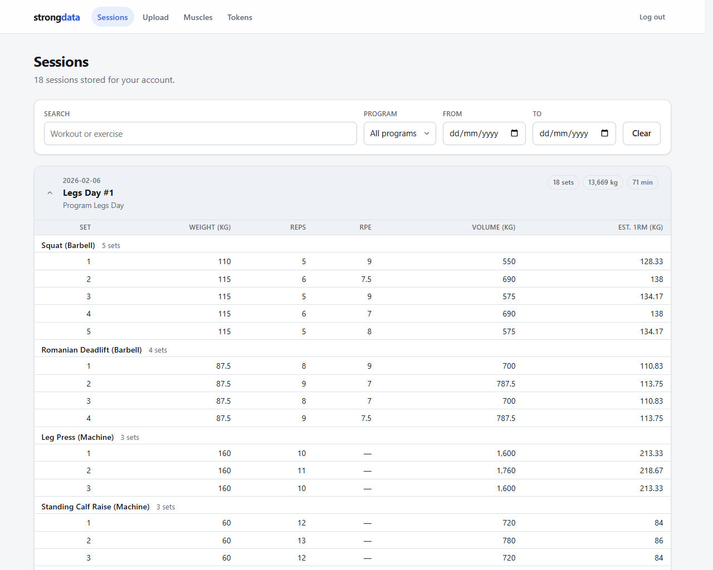
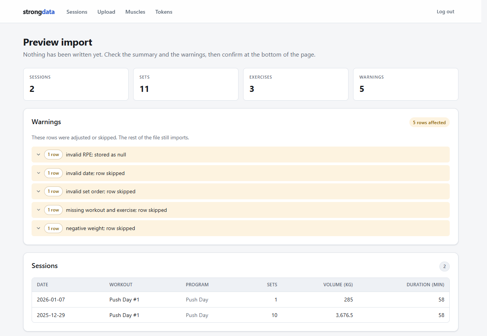

<p align="center">
  <picture>
    <source media="(prefers-color-scheme: dark)" srcset="docs/images/wordmark-on-dark.png">
    
  </picture>
</p>

Self-hosted import of your Strong workout CSV into a private SQLite database, with
a server-rendered web UI and a read-only JSON API.

Strong has no API and no way to get your training history out except its own CSV
export. This app imports that export, keeps it in one SQLite file you own, and
turns it into something you can read: sessions, per-exercise progress, personal
records, muscle-group corrections and a token-authenticated API.

- One container, one database file: no external services, no sidecar, no
  telemetry, nothing loaded from a CDN
- Idempotent import: confirming an export replaces what is stored instead of
  duplicating it
- Read-only, versioned, owner-scoped API with a generated OpenAPI reference

## What it looks like

**Sessions** are the home page: newest first, one row per workout, opened to its
sets with weight, reps, RPE, volume and estimated 1RM, grouped per exercise. Text,
program and date filters narrow the list.



**Importing** is always two steps. The preview lists the sessions in the file, a
sample of their sets, and every row that would be skipped or blanked together with
the reason — so a bad export is caught before it replaces anything.



## Quick start

Docker Engine 24+ with a current Compose release, on `amd64` or `arm64`, behind a
TLS-terminating reverse proxy.

```sh
mkdir -p data && sudo chown -R 1000:1000 data
cp .env.example .env       # set STRONG_SECRET_KEY and STRONG_ALLOWED_HOSTS
docker compose up -d
```

Then attach your proxy to the `strong-data` network, forward it to `web:8000`,
[create the first account](docs/deployment.md#accounts) and log in.
[Deployment](docs/deployment.md) covers every variable, both proxy patterns,
upgrades and backups.

## Documentation

- [Using the app](docs/usage.md)
- [Deployment](docs/deployment.md) — variables, reverse proxy, upgrades
- [Backup and recovery](docs/backup-and-recovery.md)
- [API](docs/api.md) — the interactive reference is served at `/api/v1/docs`
- [Development](docs/development.md), [contributing](CONTRIBUTING.md) and the
  [security policy](SECURITY.md)

## License

PolyForm Noncommercial 1.0.0: source-available, not OSI open source. Run, modify
and share it for any noncommercial purpose, including a home lab, a nonprofit or
research use. Commercial use needs a separate license, arranged through this
repository's Discussions. See [LICENSE](LICENSE) and [NOTICE](NOTICE).

Contributions are accepted under the [CLA](CLA.md), which keeps your copyright and
grants the project the rights that dual licensing needs.
