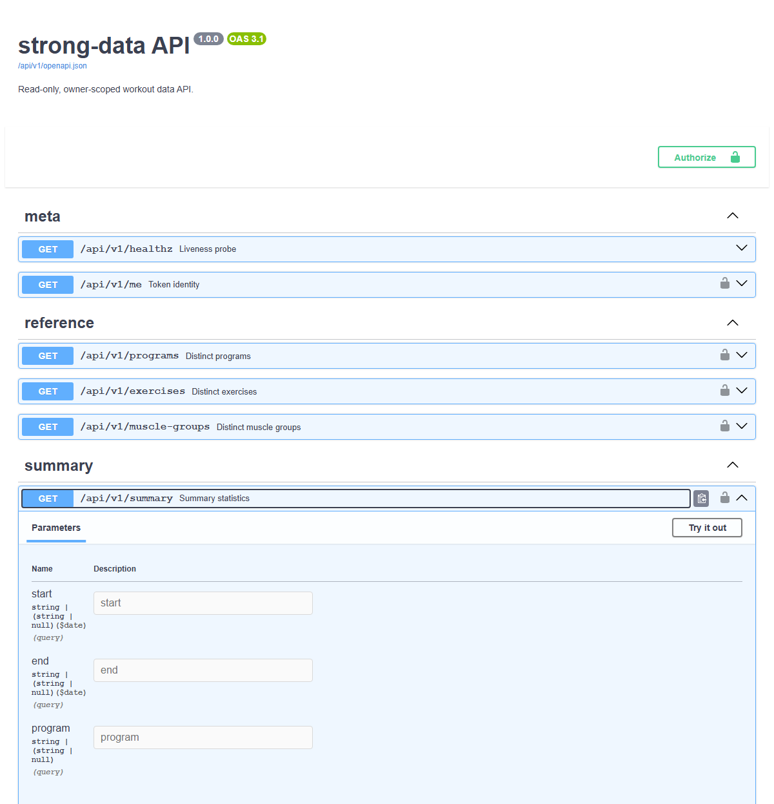

# API

The API is read-only, versioned and owner-scoped, served at `/api/v1/`. The
generated OpenAPI schema at `GET /api/v1/openapi.json` describes every path,
parameter and response shape, and a Swagger UI renders it at `GET /api/v1/docs`;
both are also reachable from a logged-in browser. Use the schema as the reference
for fields, types and per-operation parameters. This page covers what a schema
cannot express: authentication, the response envelope, the validation guardrails
and the definitions behind each derived number.

## Auth

- `GET /api/v1/healthz` is the only anonymous endpoint. It queries a required
  application table (`workouts_workoutsession`) and answers
  `503 service_unavailable` when that check fails, so a load balancer can use it
  as a readiness probe: a migrated but still empty database is ready, a missing
  or unreadable one is not.
- Every other endpoint under `/api/v1/` requires `Authorization: Bearer <secret>`
  and is verified before any other guard runs, so an unauthenticated request
  gets `401` even when it would also be oversized or a disallowed
  method. The token resolves to a user and **every** queryset is scoped to that
  user; no user identifier appears in any URL. A missing, malformed, revoked or
  expired token returns `401` with `WWW-Authenticate: Bearer`. Only a SHA-256
  hash and an 8-character prefix are stored, and comparison is constant-time.
  Secrets are created on `/tokens/` in the web UI and shown once.
- `GET /api/v1/docs` and `GET /api/v1/openapi.json` additionally accept a
  logged-in browser session, because a browser cannot attach a bearer token. The
  data endpoints never do.
- Any other path under `/api/` (for example `/api/v2/...`) is not part of the
  versioned API and returns the JSON `404 not_found` envelope, not an HTML page.
- Request bodies are capped at 10 MB: a declared `Content-Length` above that
  gets `413 payload_too_large`. Chunked request bodies are accepted like any
  other body — the server buffers them and refuses anything above its own 11 MB
  limit before the body reaches the app — so the same cap applies to them.

## Envelope

Every response, including errors, carries `contract_version` (the string `"1.0"`)
and `generated_at` (the UTC instant the read snapshot was taken). Additive fields
keep this version; a breaking shape change requires a new version. Every response
sets `Cache-Control: no-store`.

Collections add `items`, the complete filtered `count`, `next`/`previous`
continuation paths and `has_more`. Errors add `error` with `code`, `message` and
`details` (`details` is null when not applicable), and unmatched URLs anywhere
under `/api/` return the same envelope (`404 not_found`) instead of an HTML
error page. The shapes are in the schema; the stable error codes are:

| Status | `error.code` |
| --- | --- |
| 400 | `bad_request` |
| 401 | `invalid_credentials` |
| 403 | `permission_denied` |
| 404 | `not_found` |
| 405 | `method_not_allowed` |
| 409 | `conflict` |
| 413 | `payload_too_large` |
| 415 | `unsupported_media_type` |
| 422 | `validation_error` |
| 500 | `internal_error` |
| 503 | `service_unavailable` |

Unexpected failures are `internal_error`; only transient conditions, such as a
locked database, are `service_unavailable`.

## Format

Dates are ISO `YYYY-MM-DD`; timestamps are ISO 8601 in UTC with a trailing `Z`
(for example `2026-01-05T09:00:00Z`). Numeric values are JSON numbers and missing
values are `null`, never `0`.

The export records wall-clock times without an offset. A new session interprets
them in the installation's `STRONG_TIME_ZONE` (default `UTC`) and keeps that zone
for later merges. Two installations with different import zones can store different
UTC instants from the same file.

## Validation guardrails

- Integer fields reject floats, booleans and non-integer strings (so `limit=50.5`
  and `limit=true` are `422`). Boolean fields accept only the literal strings
  `true` and `false` (so `weighted=1` is `422`). Date fields must be valid
  `YYYY-MM-DD` values. Unknown query parameters, repeated query parameters,
  invalid enum values and unparseable values are `422` — including on routes that
  declare no filters, where any query parameter is `422`. No value is silently
  coerced to zero or clamped.
- `start <= end` is required and a span of more than 1830 days (about five years)
  is `422`. Series endpoints scale that cap with `bucket`, because a coarser
  bucket covers more days: `day` keeps 1830 days, `week` allows 12810 days
  (1830 weeks), `month` 56730 days (1830 months) and `year` 669780 days
  (1830 years). `limit` must be between 1 and 1000 and `offset` must be `>= 0`;
  values outside those bounds are `422`, not clamped.
- Where a date range is omitted, the effective range is the span of the owner's
  data within that endpoint's other filters, or empty when there is no data.
- Aggregated endpoints return summaries; raw sets are opt-in via the raw
  endpoints.

## Collections

`items` holds the page, `count` the complete filtered total, and `next`/`previous`
are relative paths that preserve every other query parameter. `sort` takes one of
the keys the operation lists in the schema, optionally prefixed with `-` for
descending order, and always appends `id` ascending as a unique tiebreaker. The
default `limit` is 50.

## Derived fields

These are computed once at import time and stored, so the numbers below have a
single definition:

- `volume_kg` — `COALESCE(weight_kg, 0) * reps`. A bodyweight set (no weight, or
  a `Weight` of `0`) therefore has zero volume and appears only in bodyweight
  records.
- `est_1rm_kg` — Epley, `weight_kg * (1 + reps / 30)`, null when the set has no
  weight or no reps. Strong's own UI shows Brzycki instead; using Epley is
  deliberate and no 12-rep cap is applied anywhere.
- `program` — `workout_name` with a trailing ` #N` stripped. Sessions are keyed by
  the raw `workout_name`; `program` is only a grouping and filter dimension.
- `set_count` and `total_volume_kg` — aggregates over a session's sets.

`rpe` is nullable (6.0–10.0 in 0.5 steps) and feeds none of these fields or any
aggregate.

## Filters

`start`, `end`, `program`, `exercise`, `muscle` and `weighted` are accepted only
where the schema lists them. `program`, `exercise` and `muscle` match exactly and
`program` is the derived value described above, so `program=Push Day` matches
`Push Day #1` and `Push Day #2`.

An empty `program` is the same as omitting it, so a dashboard's All option can
always send the parameter.

`program` is available on `/summary`, `/sessions`, `/sets`, every `/series/*`
endpoint, every `/breakdown/*` endpoint, `/yearly`, `/yearly/pace`,
`/yearly/curve`, both `/exercises/{name}/*` endpoints, `/records/est-1rm`,
`/records/bodyweight` and `/records/personal-bests`. `start` and `end` are also
accepted by the three record endpoints, so a record list can describe one period
or one program instead of all history. Series `group_by` stays independent of the filter:
filtering to one program and grouping by program returns that single group.

## Summary

`GET /summary` returns `sessions` and `sets` (matching sessions and the sum of
their `set_count`), `volume_kg` and `volume_t` (`volume_kg / 1000`), `hours` (sum
of `duration_min`, null counting as 0, divided by 60), `sessions_per_week`
(`sessions / weeks`, where `weeks = max(effective_span_days + 1, 1) / 7`),
`avg_volume_per_session` (`volume_kg / sessions`), `avg_session_min` (total
`duration_min` / sessions) and `days_since_last_session` (`(today -
latest session_date).days`, null when there are none). All derived numbers are
rounded to two decimals, and averages are 0 when there are no sessions.

## Time series

`bucket` starts on the day, the Monday of the ISO week, the 1st of the month or
the 1st of the year. Every bucket between the effective start and end is present,
zero-filled; when both `start` and `end` are supplied the whole interval is
zero-filled even if no sessions match it.

- `sessions` counts sessions; `volume` sums set `volume_kg`; `training-time` sums
  session `duration_min / 60`; `volume-per-session` is bucket volume / bucket
  session count (0 if none).
- `moving_average=true` is valid only with `bucket=week` (otherwise `422`) and
  adds `value_4wma`: the mean of the current and previous three bucket values, or
  `null` for the first three buckets. It applies to the series `value`, not to
  group values.
- `groups` is `null` without `group_by`, otherwise one `{key, value}` entry per
  group seen in the series (missing buckets are 0). `group_by` is accepted only
  where the schema offers it: `program` on every series endpoint, `muscle` and
  `exercise` on `/series/volume`. Group values for `volume` come from set
  `volume_kg`; a set's muscle group is its exercise's `exercise_meta.muscle_group`,
  falling back to `Other`.
- `program` filters every series endpoint (see Filters). Only matching sessions
  and sets are counted and grouped, and the zero-filled buckets cover the
  default range or the supplied `start`/`end`. The date-range cap is scaled by
  `bucket` as described under Validation guardrails, so a `bucket=month` series
  may span more than five years while `bucket=day` may not.

## Breakdowns

`count` is the number of rows before `limit` is applied, so a truncated breakdown
is detectable; `items` holds at most `limit` rows. Weekday rows are in
Monday-to-Sunday order; all other breakdowns are sorted by `volume_kg` descending,
then `key` ascending.

- `weekday`: one row per weekday name, Monday first. Sessions are counted by
  `session_date`'s weekday; `sets` and `volume_kg` come from those sessions.
- `program`: one row per program; `sets` and `volume_kg` come from those sessions.
- `muscle` / `exercises`: `sessions` is the number of distinct sessions with at
  least one matching set, `sets` the number of matching sets, and `volume_kg`
  their summed volume.

All numbers are rounded to two decimals.

Every breakdown accepts the same `start`, `end` and `program` filters, so the
breakdown can describe one program or one period. A weekday breakdown always
returns all seven rows, zero-valued when the filter matches nothing.

## Exercise endpoints

Exercise names may contain `/`; percent-encode it in the path and the route still
resolves the full name.

- `progress` groups by `session_date` by default, sorted by date ascending, or by
  session when `group_by=session` is supplied, sorted by date then `session_id`.
  `best_est_1rm_kg` and `top_weight_kg` are `null` when the group has no weighted
  sets. `sets` counts the group's sets, and `session_id` is the session when
  grouping by session and `null` otherwise, so two sessions on one day stay
  separate rather than being summed into that day.
- Both accept `start`, `end` and `program`, so one exercise's history can be
  reported for one routine only.
- `records` returns one row per distinct rep count, sorted by `reps` ascending.
  The row is the best set for that rep count, tie-broken by highest weight, then
  highest `est_1rm_kg`, then most recent `set_time`; `set_count` is how many sets
  were performed at that rep count in the filtered range.
- `sets` is a paginated collection of set records (see Raw).

## Records

- `est-1rm`: one row per exercise with a non-null `est_1rm_kg`, sorted by
  `est_1rm_kg` descending. Tie-breaks: higher reps, then higher weight, then more
  recent `set_time`.
- `bodyweight`: one row per exercise with at least one bodyweight (weight null)
  set, sorted by `reps` descending. The row is the set with the most reps,
  tie-broken by most recent `set_time`.
- Both accept `start`, `end` and `program`; without them the row is the owner's
  all-time best for that exercise.
- `personal-bests` returns both kinds in one response unless `kind=strength` or
  `kind=bodyweight` narrows it. Each row holds the best set in the requested
  range with the same selection and tie-breaks as `est-1rm` and `bodyweight`, and
  compares it with the best set for that exercise before `start` (the same
  `program` filter applies).

| Field | Meaning |
| --- | --- |
| `exercise` | Exercise name |
| `kind` | `strength` (`est_1rm` selection) or `bodyweight` (`reps` selection) |
| `value` | `est_1rm_kg` for strength, `reps` for bodyweight, in the range |
| `previous_value` | The same value before `start`; `null` for a first record |
| `improvement` | `value - previous_value`; `null` for a first record |
| `is_personal_best` | True only when `previous_value` is not null and `value > previous_value`; a tie is not a PR |
| `reps`, `weight_kg`, `set_time` | The selected set; `weight_kg` is `null` for bodyweight rows |

Rows are ordered by `kind` (strength first, then bodyweight), then `value`
descending, then `exercise` ascending. A comparison needs `start`: when it is
omitted every row is an all-time best with `previous_value: null`. There is no
`limit`; each exercise appears at most once per kind. The `start <= end` and
1830-day guards apply as everywhere else.

## Yearly

- `yearly` returns one row per year with data, sorted by year ascending.
- Every yearly endpoint accepts `program`, so a yearly history can describe one
  program.
- `yearly/pace` compares `year` (default: the year of `as_of`) against the same
  point in the previous year:

| Field | Meaning |
| --- | --- |
| `ytd` | `{sessions, sets, volume_kg, hours}` from Jan 1 of `year` through `as_of` |
| `last_year_to_date` | Same fields for `year - 1` through the same month/day |
| `projected` | `ytd / elapsed_days * days_in_year` for each field |
| `needed_per_week` | `max(last_year_full - ytd, 0) / remaining_weeks` for each field; 0 when no weeks remain |
| `pace` | Rows `{year, sessions, volume_kg, cumulative_sessions, cumulative_volume_kg}` for all years through `year` |

`year` must be between 2 and 9999 so that both the compared year and its
predecessor are valid; other values are `422`. The `as_of` month/day is
interpreted inside the selected year: `ytd`, `last_year_to_date`, `elapsed_days`
and the projection all use that same cutoff (clamped for leap days), so an `as_of`
from another year never compares a full year against a partial one. `elapsed_days`
includes the cutoff; `days_in_year` is 365 or 366; `remaining_weeks =
(days_in_year - elapsed_days) / 7`. Projections and weekly needs are computed from
unrounded totals; all numbers in the response are rounded to two decimals.

`pace` accumulates whole years, so its rows carry no position inside the year.
It counts the compared year up to `as_of`, so its last row is comparable with
`ytd`.

`GET /yearly/curve` is the within-year view and is requested separately, because
it is the only response whose size depends on how many years are asked for:

| Parameter | Meaning |
| --- | --- |
| `year` | Compared year; its rows stop at `as_of` (default: the year of `as_of`) |
| `years` | Comma-separated years to include. Default: `year` and the three preceding years. At most 10, each at least 2 and no later than `year` |
| `as_of` | Cutoff for the compared year, as on `/yearly/pace` |
| `program` | Routine filter |

`items` holds `{year, date, day_of_year, sessions, cumulative_sessions,
cumulative_volume_kg}` for every calendar day of every requested year. Earlier
years cover Jan 1 to Dec 31 and are zero-filled, so a requested year without
sessions still appears as a zero line; a day without a session repeats the
previous cumulative value. A chart drawn from `day_of_year` therefore compares
years directly, while `date` remains the real date in that year. Ten years is the
largest selection, which bounds the response at 3660 rows.

## Raw endpoints

With `weighted=true`, a session qualifies if it has at least one weighted set;
with `weighted=false`, only sessions whose sets are all bodyweight qualify.
`set_time` is the earliest set time in the session for session rows; session
`set_count` and `total_volume_kg` are stored at import time.
