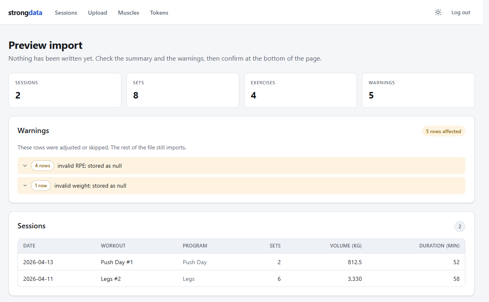
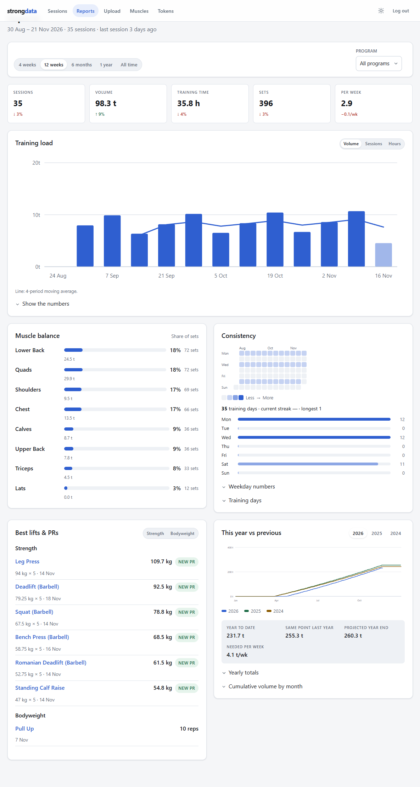

# Usage

Getting a Strong CSV export into strong-data, and reading it back.

## Appearance

The app is available in a light and a dark theme. It starts from your operating
system setting and keeps following it until you use the sun or moon button in the
header, which pins a theme for that browser. The choice is stored only in that
browser, so it survives restarts but is not tied to your account.

## Accounts

Accounts are created by an administrator; see [accounts](deployment.md#accounts)
for how the first one is made. Log in at `/accounts/login/` with the credentials
you were given. Every page needs a session, and you only ever see your own
imports, corrections and tokens.

## Import an export

Strong has no API for training history, so its CSV export is the only way in. The
upload page repeats these steps where you need them.

1. **In the Strong app**, open your profile or its settings, choose **Export
   workouts** (some versions call it **Export data**) and save the CSV.
2. **Upload** (`/upload/`) — choose the file, or drag it onto the page. It must be
   the CSV Strong exports, at most 10 MB and at most 100,000 rows; columns the app
   does not read are ignored. Choosing it opens the preview.
3. **Preview** (`/preview/`) — check the sessions, a sample of sets, and any
   warnings, then choose *Confirm import*. The sessions table lists the newest 200
   sessions of the file while the counts at the top are always the true totals.
   Confirming imports the whole file, not only the sampled sets. *Cancel* throws
   the preview away and nothing is imported; uploading again replaces the pending
   preview. An unconfirmed preview expires after one hour.
4. **Sessions** (`/sessions/`) — the imported sessions, newest first, 25 per page.
   Open a row to see its sets.


### Confirming merges into your stored data

An import **only adds**: sessions and sets that are not stored yet are inserted,
and everything already stored is kept exactly as it is. Re-importing the same
export changes nothing, and a partial or older export is safe — it adds what is
missing and never removes anything that is not in the file.

If distinct sets in a session share the same exercise, timestamp and CSV set
order, the app gives them separate stored orders. It keeps their original CSV
order for matching later imports and undo restores. Matching compares set values
at stored precision, including volume and estimated 1RM. The preview's skipped
set count includes sets already stored and repeated rows in the file.

Each session keeps the time zone it was imported in. Later exports use that zone
to match sets in the session, including after a server time zone change. New
sessions use the server's current setting.

What a re-import does with changes you made in Strong:

| Change in Strong | After re-import |
| --- | --- |
| Added a workout or sets | They are added |
| Edited a set (weight, reps, …) | The stored values win; the preview reports how many stored sets differ from the file |
| Deleted a workout | It stays stored — imports never delete. Use *Delete this session* inside the session on `/sessions/` (with undo), or *Delete all sessions* to remove everything |
| Deleted or inserted a set mid-workout | The shifted sets import as extra rows |
| Renamed an exercise or a workout | Its sets, or the whole session, import again as new rows; the old rows stay |
| Same workout name twice on one day | Treated as one session |

Muscle-group corrections are stored per exercise name and survive imports,
including corrections for exercises the new export does not contain.

## Warnings

Some files are rejected at upload; individual bad rows are reported on the preview
and skipped or blanked instead of failing the import.

| Problem | Result |
| --- | --- |
| Missing required columns, empty or unreadable file, no importable rows | Rejected at upload |
| More than 100,000 data rows | Rejected at upload |
| Invalid date, both the workout and exercise name missing, invalid set order or reps | Row skipped, warning |
| Negative weight | Row skipped, warning |
| Invalid weight, distance or seconds | Stored empty, warning |
| Negative distance or seconds | Stored empty, warning |
| RPE outside 6.0–10.0 or not in 0.5 steps | Stored empty, warning |
| Duration that cannot be parsed | Stored empty |

A row is skipped only when both names are missing. If just one is missing it is
imported as `Workout` or `Unknown`, without a warning, so check the preview for
those names.

Warnings are grouped by cause with a count, and each group lists the first 20 CSV
line numbers affected. A `Weight` of `0` is bodyweight, exactly like an empty
`Weight`: no weight is stored, it adds no volume, and it appears in bodyweight
records.

The sessions table on the preview is capped at the newest 200 sessions so a huge
export stays readable; the session and set counts above it always cover the whole
file, and confirming imports all of it.



## Sessions

`/sessions/` lists your sessions newest first with date, workout, program and
totals. Open a row for its sets with weight, reps, RPE, volume and estimated 1RM,
grouped per exercise with set numbering restarting at 1 for each exercise. It
shows what is stored now: everything you have ever imported, merged.

Three filters narrow the list: text matching the workout *or* an exercise name, a
program dropdown, and an optional date range. They combine, apply to whole
sessions (a matched session still shows all of its sets) and survive paging;
*Clear* removes them. Search is a case-insensitive substring match on the stored
names, so a search does not fold scripts and a hiragana query does not find a
katakana exercise name.

Each session has a *Delete this session* button. The *Recently deleted sessions*
list shows an *Undo delete* button for each available backup, newest first. Undo
is available in the sign-in session that deleted the workout. Signing out clears
the list. Backups expire after 24 hours by default or when the container
restarts. If a session has been re-imported, undo merges the backup using that
session's import time zone and fills a missing duration from the backup.
If the database is busy, try the delete or undo again. *Delete all sessions* at
the bottom of the page deletes every session and set for your account after a
second confirmation.
Corrections and tokens are kept, so a later import reuses your corrections instead
of re-guessing them.

The pager numbers the pages around the one you are on, and printing from the
browser expands every session, drops the navigation and prints on a white sheet
even when you use the dark theme.

There is nothing to export from the app: the Strong CSV is the export format,
and importing the same file again changes nothing.

## Reports

`/reports/` turns the stored history into training totals and trends. Every block
uses the same query layer as the API, so a number on the page and the same number
from `/api/v1/summary` are computed once, not twice.



### Range and filters

The range chips select `4 weeks`, `12 weeks`, `6 months`, `1 year` or `All time`
(the default is 12 weeks). The program dropdown narrows every block to one stored
program; *All programs* clears it. Both survive the training-load switch and the
focus year, and the whole state is in the URL, so a view can be bookmarked. No
JavaScript is needed: the program form has an *Apply* button, which the browser
script hides when it is available so changing the dropdown applies at once.

Ranges are exact, not rounded to whole weeks or months. A week or month that only
partly overlaps the range is drawn dimmer and marked *partial* (or *in progress*
for the current one), but no set is left out of the totals. The *All time* range
is fetched one calendar year at a time, so it works for histories longer than the
API's five-year request limit.

### Blocks

- **Headline totals** — sessions, volume in tonnes, training time, sets and
  sessions per week for the selected window, each compared with the immediately
  preceding window of the same length. A percentage against a zero previous value
  is shown as `—`; *All time* has no comparison.
- **Training load** — volume, sessions or hours per week or month. Weekly ranges
  with at least eight buckets add a four-bucket moving average. *Show the numbers*
  repeats the same data as a table.
- **Muscle balance** — share of sets per muscle group, using your corrections.
  The top eight groups are shown and the tail is folded into `Other`, together
  with any exercise that has no mapping. The bar is the share of sets and the
  secondary text is volume, so a high-set bodyweight group still ranks correctly.
- **Consistency** — a calendar heatmap of sessions per day (capped at 53 weeks,
  with the current streak and the number of distinct training days), plus sessions
  per weekday. Hover a cell for its date and count; both have a text table.
- **Best lifts & PRs** — the best estimated 1RM per exercise for strength and the
  best reps for bodyweight, top six of each. `NEW PR` means the range's best
  strictly beats everything before `start`; a first record says *First recorded*;
  a tie is neither. Each row opens the exercise report.
- **This year vs previous** — cumulative volume for the focus year and up to two
  earlier years with data, with a month-by-month table. For the current year the
  footer shows year to date, the same point last year, a projection and the volume
  needed per week to match last year; the projection is withheld until at least
  four weeks of the year have elapsed. An earlier focus year is a full year with
  its own total and change, and no projection.

### Definitions

Volume is the stored set volume (`weight_kg * reps`), so a bodyweight set adds no
volume. Estimated 1RM uses Epley's formula, as the API does. A *PR* is strictly
better than the best set before the selected period; *best in period* alone is not
labelled a PR. Streaks count consecutive calendar days with at least one session;
*current* is shown only when the latest training day is today or yesterday.
Training days are distinct dates, not sessions.

### Exercise reports

The drill-down at `/reports/exercise/<name>/` follows the same range and program
chips. It plots the best estimated 1RM per session (or max reps when the exercise
has no weighted sets), lists the best set at each rep count in the period, and
repeats the per-session numbers as a table. An exercise with no sets in the range
shows an empty message instead of a 404; an unknown or foreign exercise name is a
404.

### Printing

Printing from the browser hides the toolbar and chart switches, opens the data
tables and keeps cards together, so the page prints as a readable report. A PDF
is the browser's print-to-PDF output; there is no separate PNG or CSV export.

## Muscles

Each new exercise name gets a guessed muscle group at import. Correct guesses on
`/muscles/`: a correction applies to that exercise name for your account and is
preserved by later imports.


The page lists 100 names at a time; edit the rows you want and choose *Save all*,
which appears once anything differs from what is stored and saves the rows on that
page. Rows holding unsaved changes are marked until you save or *Cancel* them.
*Cancel* reverts the page. A search box narrows the list by exercise name and
survives paging and saving.

Each row offers the guessed groups plus every group you already use, so a group
you invented earlier is one click away. *Custom…* accepts any name (for example
`Forearms`), and names match case-insensitively, so `chest` is stored as `Chest`
rather than as a second group. A *Custom groups* card lists the groups you named
and how many exercises use each; deleting one reverts those exercises to the
guessed group. Guessed groups are not listed, because the next import would bring
them back. Exercises the guess cannot place are grouped under `Other`; the guess
matches English exercise names, so names in other languages usually need
correcting by hand.

## API tokens

The API is read-only and authenticated with a bearer token, created on `/tokens/`:
give it a name, copy the secret when it is shown (it is displayed once) and
optionally set an expiry. Revoke a token at any time; revocation takes effect on
the next request.


```sh
curl -fsS -H "Authorization: Bearer <secret>" \
  https://workouts.example.com/api/v1/summary
```

The interactive reference is at `/api/v1/docs` once you are logged in. [API](api.md)
covers what the schema cannot express: authentication, the response envelope,
guardrails and every derived number.
