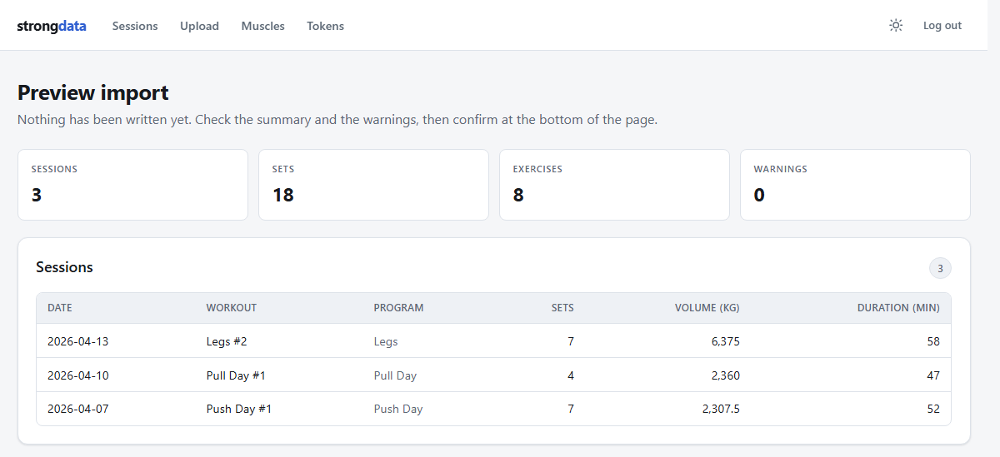
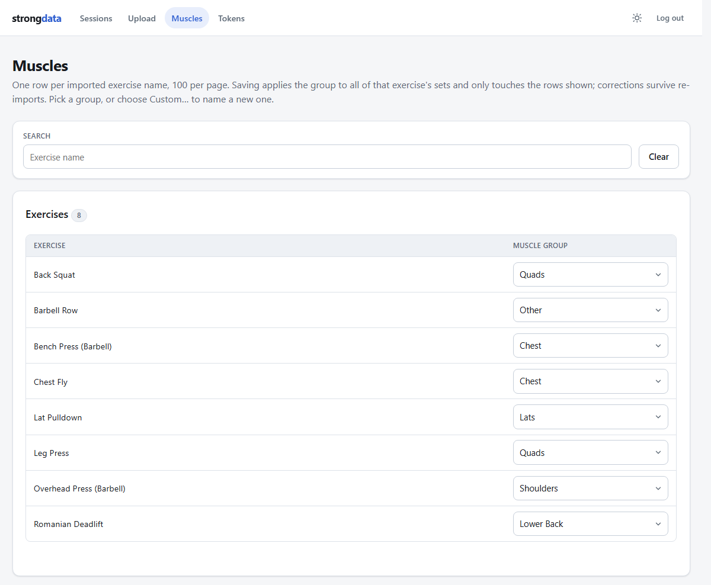
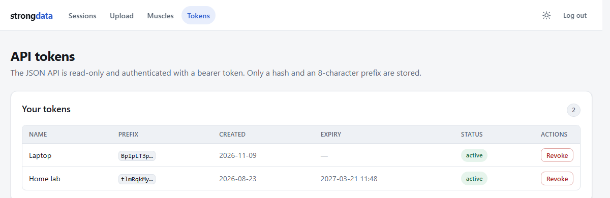

# Usage

Getting a Strong CSV export into strong-data, and reading it back.

## Appearance

The app is available in a light and a dark theme. It starts from your operating
system setting and keeps following it until you use the sun or moon button in the
header, which pins a theme for that browser. The choice is stored only in that
browser, so it survives restarts but is not tied to your account.

## Accounts

Accounts are created by an administrator; see [accounts](deployment.md#accounts)
for how the first one is made. Log in at `/accounts/login/` with the credentials
you were given. Every page needs a session, and you only ever see your own
imports, corrections and tokens.

## Import an export

Strong has no API for training history, so its CSV export is the only way in. The
upload page repeats these steps where you need them.

1. **In the Strong app**, open your profile or its settings, choose **Export
   workouts** (some versions call it **Export data**) and save the CSV.
2. **Upload** (`/upload/`) — choose the file, or drag it onto the page. It must be
   the CSV Strong exports and at most 10 MB; columns the app does not read are
   ignored. Choosing it opens the preview.
3. **Preview** (`/preview/`) — check the sessions, a sample of sets, and any
   warnings, then choose *Confirm import*. Confirming imports the whole file, not
   only the sampled sets. *Cancel* throws the preview away and nothing is
   imported; uploading again replaces the pending preview. An unconfirmed preview
   expires after one hour.
4. **Sessions** (`/sessions/`) — the imported sessions, newest first, 25 per page.
   Open a row to see its sets.



### Confirming replaces your previous data

An import **replaces everything you previously imported**: sessions, sets and
exercise names are deleted and rebuilt from the file in one transaction. That
makes re-importing the same export idempotent instead of duplicating it, and it
means you should upload the **complete** export every time — a partial export
removes everything that is not in it.

Muscle-group corrections are the exception: they are stored per exercise name and
survive imports, including corrections for exercises the new export does not
contain.

## Warnings

Some files are rejected at upload; individual bad rows are reported on the preview
and skipped or blanked instead of failing the import.

| Problem | Result |
| --- | --- |
| Missing required columns, empty or unreadable file, no importable rows | Rejected at upload |
| Invalid date, both the workout and exercise name missing, invalid set order or reps | Row skipped, warning |
| Negative weight | Row skipped, warning |
| Invalid weight, distance or seconds | Stored empty, warning |
| Negative distance or seconds | Stored empty, warning |
| RPE outside 6.0–10.0 or not in 0.5 steps | Stored empty, warning |
| Duration that cannot be parsed | Stored empty |

A row is skipped only when both names are missing. If just one is missing it is
imported as `Workout` or `Unknown`, without a warning, so check the preview for
those names.

Warnings are grouped by cause with a count, and each group lists the first 20 CSV
line numbers affected. A `Weight` of `0` is bodyweight, exactly like an empty
`Weight`: no weight is stored, it adds no volume, and it appears in bodyweight
records.


## Sessions

`/sessions/` lists your sessions newest first with date, workout, program and
totals. Open a row for its sets with weight, reps, RPE, volume and estimated 1RM,
grouped per exercise with set numbering restarting at 1 for each exercise. It
shows what is stored now, so after a replacement import it shows only the new
export.

Three filters narrow the list: text matching the workout *or* an exercise name, a
program dropdown, and an optional date range. They combine, apply to whole
sessions (a matched session still shows all of its sets) and survive paging;
*Clear* removes them. Search is a case-insensitive substring match on the stored
names, so a search does not fold scripts and a hiragana query does not find a
katakana exercise name.

*Delete all sessions* at the bottom of the page deletes every session and set for
your account after a second confirmation. Corrections and tokens are kept, so a
later import reuses your corrections instead of re-guessing them.

The pager numbers the pages around the one you are on, and printing from the
browser expands every session, drops the navigation and prints on a white sheet
even when you use the dark theme.

There is nothing to export from the app: the Strong CSV you imported is the
export, and sending it again reproduces the data.

## Muscles

Each new exercise name gets a guessed muscle group at import. Correct guesses on
`/muscles/`: a correction applies to that exercise name for your account and is
preserved by later imports.



The page lists 100 names at a time; edit the rows you want and choose *Save all*,
which appears once anything differs from what is stored and saves the rows on that
page. Rows holding unsaved changes are marked until you save or *Cancel* them.
*Cancel* reverts the page. A search box narrows the list by exercise name and
survives paging and saving.

Each row offers the guessed groups plus every group you already use, so a group
you invented earlier is one click away. *Custom…* accepts any name (for example
`Forearms`), and names match case-insensitively, so `chest` is stored as `Chest`
rather than as a second group. A *Custom groups* card lists the groups you named
and how many exercises use each; deleting one reverts those exercises to the
guessed group. Guessed groups are not listed, because the next import would bring
them back. Exercises the guess cannot place are grouped under `Other`; the guess
matches English exercise names, so names in other languages usually need
correcting by hand.

## API tokens

The API is read-only and authenticated with a bearer token, created on `/tokens/`:
give it a name, copy the secret when it is shown (it is displayed once) and
optionally set an expiry. Revoke a token at any time; revocation takes effect on
the next request.



```sh
curl -fsS -H "Authorization: Bearer <secret>" \
  https://workouts.example.com/api/v1/summary
```

The interactive reference is at `/api/v1/docs` once you are logged in. [API](api.md)
covers what the schema cannot express: authentication, the response envelope,
guardrails and every derived number.
